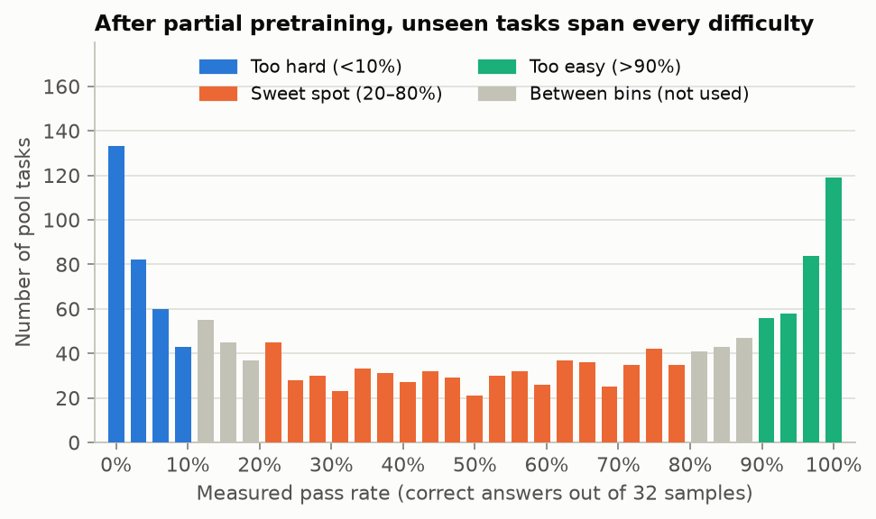
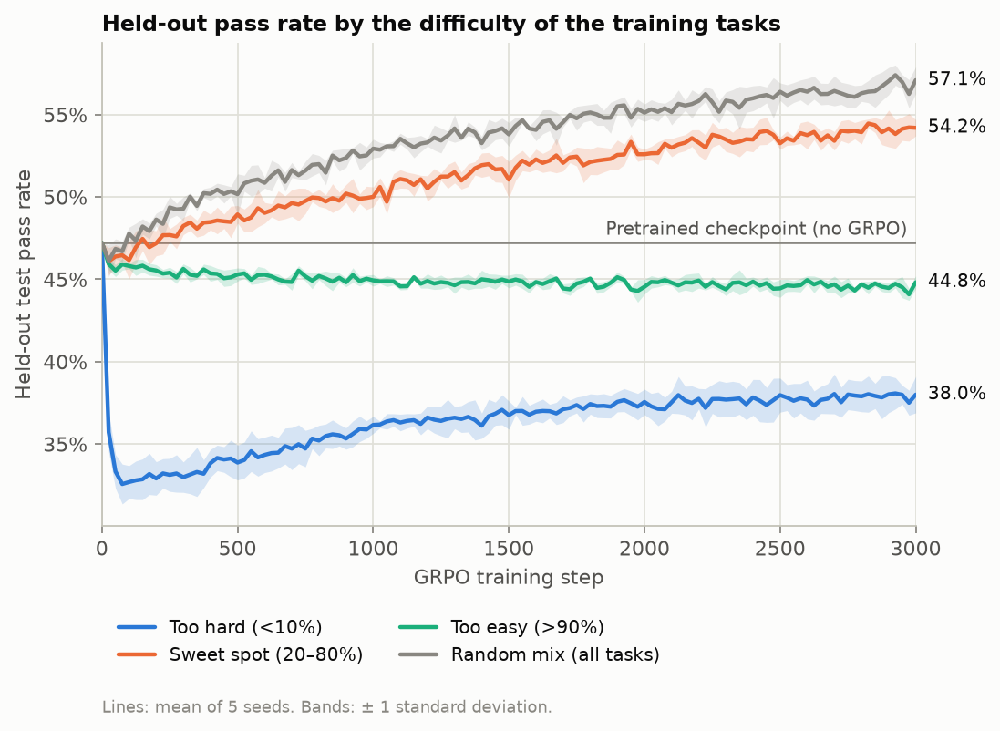
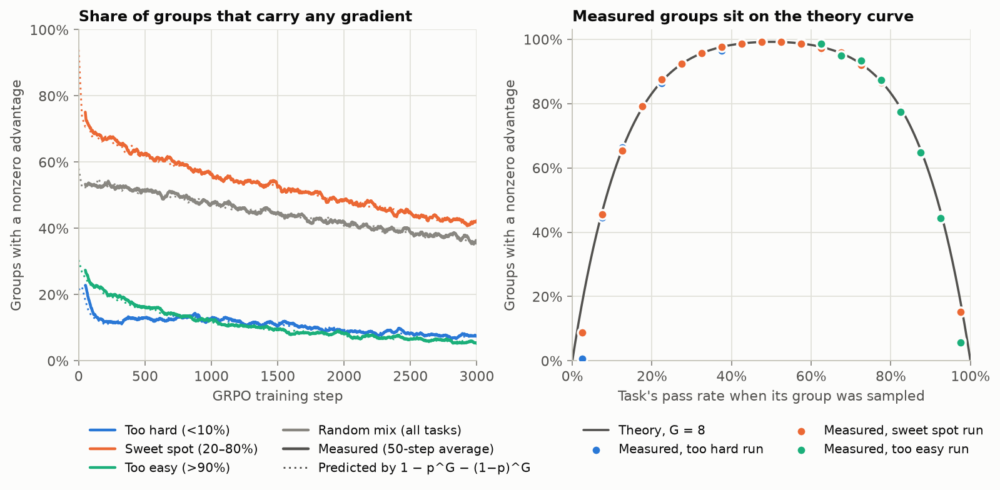

# grpo-difficulty

## The question

Does training on tasks a model solves "sometimes" (20–80% of the time) teach it more than training on tasks it always or never solves?

**Short answer from this experiment:** partly. Of the three difficulty bins, the sweet spot was the only one that improved held-out accuracy (+7.0 points; too hard −9.2, too easy −2.4). But a random mix of tasks, with no difficulty filter at all, did better than any single bin (+9.9).

## Why it matters for AI training data

GRPO, a common way to train models with rewards, scores each answer against the average of a group of answers to the same task. A group that is all correct or all wrong gives exactly zero gradient, so in theory tasks a model always or never solves are wasted compute. If that holds in practice, AI training-data brokers & the labs that buy from them should price tasks by measured difficulty rather than by volume, so it is worth testing before anyone builds a price list on it.

## Method

Everything is synthetic, small & runs on a laptop CPU in a few minutes. GRPO is written from scratch in PyTorch.

1. **Task world.** 15,360 tasks. Each task is four small integers `(a, b, x, y)` & the answer is one of 16 tokens: `((a*x + b*y) // 4) mod 16`. Think of diagonal stripes painted over a 32×32 grid: `(a, b)` sets the stripes' direction & thickness, `(x, y)` is a point, & the answer is the stripe that point falls in. Thin stripes & points near a stripe edge are harder.
2. **Policy.** A small MLP (19,216 weights) with a softmax over the 16 answers.
3. **Partial pretraining.** 2,000 steps of supervised learning on 800 tasks, stopped early on purpose. On tasks it has never seen, the policy then passes 47% of the time.
4. **Measure difficulty.** For each of 8,000 unseen "pool" tasks, sample 32 answers & count the correct ones. Bin the tasks: **too hard** (< 10%), **sweet spot** (20–80%), **too easy** (> 90%). Cut every bin to 1,500 tasks.

   

5. **Train.** From the same pretrained checkpoint, run GRPO on each bin separately, plus a fourth arm that trains on 1,500 tasks drawn at random from the whole pool (the "buy without looking at difficulty" baseline). Every run gets identical compute: 3,000 steps × 32 tasks × 8 sampled answers = 768,000 samples. 5 seeds per arm.
6. **Evaluate.** All runs are scored on the same 2,000 held-out test tasks, which no run ever trains on. The score is the pass rate: the average probability of giving the correct answer.

The learning rate was chosen once, using only the random-mix arm & a separate validation split, so that choice could not favour any bin. Details & the dead ends along the way are in [BUILDLOG.md](BUILDLOG.md).

## Results



| Trained on | Pass rate of its training tasks at the start | Groups with signal at the start | Held-out pass rate after training (mean ± sd, 5 seeds) | Change |
| --- | --- | --- | --- | --- |
| Nothing (pretrained checkpoint) | | | 47.2% | |
| Too hard (< 10%) | 3.6% | 21% | 38.0% ± 1.1% | −9.2 pts |
| **Sweet spot (20–80%)** | 51.6% | 94% | **54.2% ± 0.5%** | **+7.0 pts** |
| Too easy (> 90%) | 94.8% | 30% | 44.8% ± 0.4% | −2.4 pts |
| **Random mix (no filter)** | 46.7% | 58% | **57.1% ± 0.8%** | **+9.9 pts** |

**1. The sweet spot beat both extremes, & was the only single bin that helped.** The ranking sweet spot > too easy > too hard was the same for group sizes 4, 8 & 16, with & without dividing the advantage by its standard deviation, at four learning rates, & on four reshuffled worlds with freshly pretrained checkpoints.

**2. An unfiltered random mix beat the sweet spot** by about 3 points, more than the spread between seeds. It did so in every ablation & every replicate too. I did not expect this.

**3. The zero-gradient theory is exactly right step by step, but it is not what decided the outcome.**



The share of groups with a nonzero advantage follows the formula `1 − p^G − (1−p)^G` closely (right panel). The sweet-spot run started with 94% of its groups carrying signal, against 21% for too hard & 30% for too easy.

But the too-hard run was not starved. 21% was enough to get going: its own training tasks went from 3.6% to 51.6%. It lost because it forgot everything else:

| Trained on | Test tasks that started too hard | Test tasks that started in the sweet spot | Test tasks that started too easy |
| --- | --- | --- | --- |
| Too hard | 2.5% → 49.6% | 49.8% → 35.8% | 95.9% → 25.3% |
| Sweet spot | 2.5% → 16.0% | 49.8% → 68.7% | 95.9% → 69.2% |
| Too easy | 2.5% → 2.3% | 49.8% → 43.2% | 95.9% → 98.0% |
| Random mix | 2.5% → 30.3% | 49.8% → 62.1% | 95.9% → 79.6% |

Each single-bin run improves test tasks of its own difficulty & damages others. The mix wins because it covers every difficulty at once. (The same numbers as a chart: [figures/gain_by_difficulty.png](figures/gain_by_difficulty.png).)

**4. Too-easy tasks teach nothing new, but they stop forgetting.** Two follow-up arms, added after seeing the result above:

| Trained on | Held-out pass rate | Change |
| --- | --- | --- |
| Random mix | 57.1% ± 0.8% | +9.9 pts |
| Random mix with the too-hard bin removed | 56.5% ± 0.3% | +9.3 pts |
| Random mix with the too-easy bin removed | 54.1% ± 0.5% | +6.9 pts |

Removing the too-hard tasks made no difference beyond noise. Removing the too-easy tasks cost 3 points, because test tasks that started easy fell from 95.9% to 51.6%.

**Robustness** (held-out pass rate at the end, mean over 3 seeds):

| Setting | Too hard | Sweet spot | Too easy | Random mix |
| --- | --- | --- | --- | --- |
| Main (G = 8, lr 0.001, 5 seeds) | 38.0% | 54.2% | 44.8% | 57.1% |
| G = 4 | 36.6% | 56.1% | 44.6% | 57.8% |
| G = 16 | 37.6% | 52.8% | 44.6% | 55.4% |
| Advantage ÷ std | 36.7% | 53.9% | 44.5% | 56.6% |
| lr 0.0001 | 35.4% | 50.5% | 46.0% | 51.8% |
| lr 0.0003 | 36.5% | 51.3% | 45.4% | 54.3% |
| lr 0.003 | 31.2% | 48.1% | 41.6% | 54.1% |
| Reshuffled world 1 (start 44.3%) | 37.9% | 52.1% | 41.3% | 56.3% |
| Reshuffled world 2 (start 44.2%) | 33.6% | 50.0% | 40.1% | 53.6% |
| Reshuffled world 3 (start 44.4%) | 36.4% | 48.6% | 42.1% | 53.3% |
| Reshuffled world 4 (start 45.8%) | 34.2% | 49.8% | 40.8% | 53.8% |

## Limitations

- **It is a toy.** Four input numbers, a 19,216-weight MLP & single-token answers. Nothing here is a coding task, & nothing here shows the same numbers would appear with a language model.
- **Forgetting is probably exaggerated.** A tiny network trained with plain GRPO has no protection against overwriting what it knew. Real pipelines use much larger models, clipped updates & a penalty for drifting from the starting policy. The damage from single-bin training (results 1 & 3) could shrink a lot there, which would also shrink the random mix's lead.
- **"Too hard" here is not "impossible".** The too-hard bin's median true pass rate was 1.7%, so about one group in five still carried signal, & nearby tasks helped each other. Real coding tasks can sit at effectively 0%, where the zero-gradient argument applies in full. This experiment did not isolate that regime.
- **Every hard task here is learnable.** Tasks are hard because the stripes are thin, not because the task is broken. Real too-hard tasks are often hard because the verifier is wrong or the task is underspecified, & those teach nothing at any budget.
- **The verifier is perfect.** Rewards are exact, with no false positives or false negatives.
- **Equal compute means equal samples.** In practice a hard task costs more tokens per attempt than an easy one, which this setup ignores.
- **Difficulty is measured once.** Bins are fixed before training. A task that starts too hard becomes a sweet-spot task as the model improves, & nothing here re-measures.
- **The test set covers all difficulties.** A buyer who only cares about hard tasks would read the table differently: too-hard training gave by far the largest gain on hard test tasks (+47 points).
- **One model strength.** The checkpoint passes about 47% of unseen tasks. A much weaker or much stronger starting model was not tried.
- **The learning rate was chosen on the random-mix arm,** which could favour it. The ranking of the arms was the same at all four learning rates tried.

## What I'd try next

1. **Find the real zero-gradient wall.** Split the too-hard bin into "0 of 32 correct" & "1–3 of 32 correct" & train on each, across group sizes. The theory says the first group should stall at small G.
2. **Separate signal from forgetting.** Add a penalty for drifting from the starting policy, or replay a few easy tasks, then ask the bin question again. If single bins stop hurting, the sweet spot may overtake the mix.
3. **Sweep the blend.** Train on mixes with 25%, 50% & 75% sweet-spot tasks to find the best proportion, rather than all or nothing.
4. **Re-measure during training.** Refresh pass rates every few hundred steps & always train on the current sweet spot.
5. **A noisy verifier.** Flip a share of rewards & see which bin is hurt most by false positives.
6. **A real small benchmark.** Repeat with a small language model on a public set of coding tasks, using pass@k from `passk.py` to measure difficulty.

## How to run

```bash
conda create -n grpo-difficulty -c conda-forge python=3.11 -y
conda activate grpo-difficulty
pip install -r requirements.txt

make all     # or: python run_all.py
```

That one command rebuilds every figure in `figures/` & every number above (printed, & saved to `outputs/summary.md`). It takes about 5 minutes on a laptop CPU. All seeds are fixed, so two runs on one machine give identical numbers; a different machine or PyTorch build may differ in the last decimal place.

Run the tests with `make test` (75 tests, about 15 seconds).

## What's in the repo

| File | What it does |
| --- | --- |
| `grpo_difficulty/passk.py` | Unbiased pass@k estimator, the naive estimator & a bootstrap confidence interval |
| `grpo_difficulty/signal.py` | The theory: share of GRPO groups that carry any gradient |
| `grpo_difficulty/world.py` | The synthetic task family & its four non-overlapping splits |
| `grpo_difficulty/policy.py` | The MLP policy, pretraining, pass-rate measurement & bins |
| `grpo_difficulty/grpo.py` | GRPO from scratch |
| `grpo_difficulty/experiment.py` | The experiment, ablations & replicates |
| `grpo_difficulty/plots.py` | Figures & summary tables |
| [EXPLAIN.md](EXPLAIN.md) | A plain-language walkthrough of how it all works |
| [BUILDLOG.md](BUILDLOG.md) | What was built in what order, what failed & why decisions were made |

Two supporting figures are not shown above: [the naive pass@k estimator's bias](figures/passk_bias.png) & [the theory curve for G = 4, 8 & 16](figures/signal_theory.png).

## Notes

- All data in this project is synthetic & generated by the code. There are no real traces, no customer data & no secrets.
- The pass@k estimator follows Chen et al., "Evaluating Large Language Models Trained on Code" (2021). GRPO follows Shao et al., "DeepSeekMath" (2024).
- Licence: MIT.
